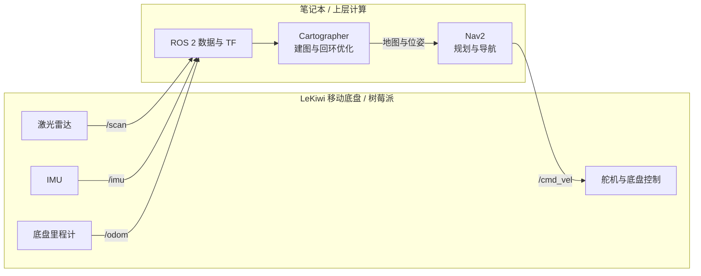
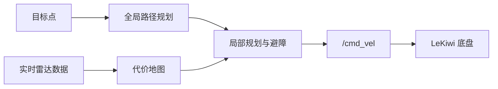
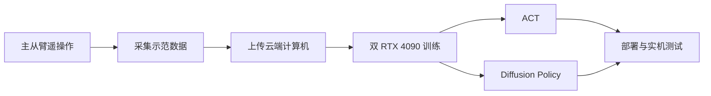

# LeKiwi + SO-ARM101 移动操作机器人

> 一套融合自主移动、环境建图、导航与机械臂模仿学习的移动操作机器人系统。

本项目基于 LeKiwi 移动底盘与 LeRobot SO-ARM101 机械臂平台，重点完成了硬件适配、ROS 2 分布式架构、Cartographer 建图、Nav2 导航，以及机械臂模仿学习任务的完整落地。

## 项目亮点

- 将底层硬件控制与上层计算任务分离，构建了“树莓派 + 笔记本”的 ROS 2 分布式系统。
- 面对低成本激光雷达引起的 SLAM 漂移和发散，完成问题定位、算法评估，并将建图方案由 SLAM Toolbox 切换为 Cartographer。
- 打通从传感器采集、地图构建、路径规划到运动控制的完整 Nav2 导航链路。
- 使用主从臂遥操作采集真实机器人数据，在双 RTX 4090 云端环境中训练 ACT 与 Diffusion Policy。
- 成功完成地面捡物、低处取物和开门三个移动操作任务，并对两类模仿学习模型进行了实际对比。

## 我的主要工作

我主要负责移动底盘的 SLAM、ROS 2 节点搭建与系统集成，包括：

- 设计树莓派与笔记本之间的 ROS 2 分布式计算架构。
- 接入激光雷达、IMU 和底盘里程计，整理传感器话题与 TF 坐标关系。
- 搭建并调试建图、定位、导航和底盘控制相关节点。
- 分析 SLAM Toolbox 在实际硬件上的漂移与发散问题。
- 评估并切换到 Cartographer，针对低精度雷达和室内环境完成参数调试。
- 将 Cartographer 与 Nav2 对接，实现地图构建、路径规划和速度控制闭环。
- 配合完成 SO-ARM101 的遥操作数据采集、云端训练、模型部署与任务验证。

这个项目的重点不是简单地启动若干现成模块，而是在传感器精度有限、边缘计算资源受限、学习模型特性差异明显的条件下，完成系统拆分、问题定位、算法替换和软硬件联合调试。

## 系统架构

移动底盘采用分布式架构。树莓派靠近硬件，只处理传感器读取和底盘实时控制；计算量较大的建图、导航与决策任务运行在笔记本上。两端通过 ROS 2 DDS 通信。



这种拆分带来了三个直接收益：

1. 树莓派专注硬件通信和实时控制，减少计算负载对底盘控制稳定性的影响。
2. 笔记本能够为 Cartographer、Nav2 和后续学习算法提供更充足的计算资源。
3. 各模块通过标准 ROS 2 话题连接，便于单独调试、替换和扩展。

## 移动底盘：从建图到导航

### 1. ROS 2 节点与数据链路

树莓派负责采集激光雷达、IMU 和底盘里程计数据，同时执行来自笔记本的速度指令。笔记本订阅传感器话题，维护坐标变换，并运行建图与导航节点。

整条控制链路为：

```text
雷达 / IMU / 里程计
        ↓
树莓派 ROS 2 节点
        ↓ DDS
笔记本：建图 / 定位 / Nav2
        ↓ /cmd_vel
树莓派底盘控制器
        ↓
舵机执行
```

### 2. SLAM Toolbox 遇到的问题

项目早期使用 SLAM Toolbox。实际测试中，受激光雷达测量精度、扫描稳定性和环境特征等因素影响，扫描匹配结果不稳定，地图会逐渐出现漂移，严重时甚至发散。

这类问题无法只靠反复修改单个参数解决。因此，我重新检查了传感器数据、TF 关系、里程计输入和建图链路，并对不同 SLAM 方案进行了实际测试。

### 3. 切换到 Cartographer

最终采用 Cartographer 作为建图方案。选择它的主要原因不是追求单帧扫描的极限精度，而是希望利用多传感器约束与回环优化，降低累计误差对全局地图的影响。

切换过程中完成了：

- 激光雷达、IMU 和里程计输入的统一。
- ROS 2 话题、时间戳与 TF 坐标树检查。
- 局部轨迹、子地图和回环检测相关参数调试。
- 建图效果、闭环一致性和机器人运动稳定性的实机验证。

在当前传感器配置和室内场景下，Cartographer 的整体效果更稳定，能够满足项目对地图精度和回环能力的需求。

### 4. Nav2 导航

地图构建完成后，使用 Nav2 完成自主导航。Nav2 在笔记本上运行，负责代价地图、路径规划、局部避障和速度指令生成；树莓派接收 `/cmd_vel` 并驱动底盘执行。



通过这种方式，建图、定位、规划与控制形成了完整闭环，同时保留了各模块独立替换和调试的能力。

## 机械臂：模仿学习与实机任务

机械臂部分使用 SO-ARM101 主从臂进行遥操作。操作者控制主臂完成动作，从臂同步执行并记录观测与关节动作，由此获得真实机器人示范数据。

### 数据与训练流程



完整流程包括：

1. 设计并重复执行目标任务，采集质量稳定的示范轨迹。
2. 检查数据完整性，将数据集上传至云端计算机。
3. 配置 LeRobot 训练环境与双 RTX 4090 计算资源。
4. 根据数据规模和任务表现调整学习率等训练参数。
5. 分别训练 ACT 与 Diffusion Policy，并将模型部署回真实机械臂测试。

### 完成的任务

| 任务 | 主要挑战 | 最终结果 |
|---|---|---|
| 地面捡物 | 目标位置低、抓取空间受限 | 成功完成抓取与抬升 |
| 低处取物 | 需要稳定到达目标并完成精细抓取 | 成功完成取物动作 |
| 开门 | 动作过程长，包含接近、操作和持续运动 | 成功完成完整动作流程 |

## ACT 与 Diffusion Policy 对比

两种模型都能学习示范动作，但实机表现存在明显差异。

| 对比项 | ACT | Diffusion Policy |
|---|---|---|
| 推理体验 | 动作响应相对直接 | 推理速度较慢 |
| 环境变化适应性 | 对位置和环境变化较敏感 | 对小范围环境变化更稳健 |
| 实机表现 | 在接近训练分布时效果较好 | 整体成功率和泛化表现更好 |
| 主要问题 | 环境稍有变化就可能抓取失败 | 推理延迟会影响动作实时性 |

ACT 的优势是结构直接，但对训练数据分布依赖较强。当物体位置、姿态或环境发生变化时，抓取成功率会明显下降。Diffusion Policy 对变化的适应能力更强，实际任务效果更好，但推理速度较慢，需要在模型效果与实时性之间权衡。

## 最终成果

本项目最终完成了两个相互连接的机器人能力闭环：

- **移动能力闭环：** 传感器采集 → ROS 2 数据传输 → Cartographer 建图与回环 → Nav2 路径规划 → 底盘执行。
- **操作能力闭环：** 主从臂遥操作 → 数据采集 → 云端训练 → 模型部署 → 真实机械臂执行。

项目不仅验证了移动底盘与机械臂各自的功能，也积累了以下完整工程经验：

- ROS 2 分布式系统与节点集成。
- 多传感器数据、时间同步与 TF 调试。
- SLAM 漂移和发散问题的定位与算法替换。
- Cartographer 与 Nav2 的建图导航链路搭建。
- 真实机器人示范数据采集与质量控制。
- 双 GPU 训练环境配置、超参数调整和模型部署。
- ACT 与 Diffusion Policy 的实机评估和技术取舍。

## 技术栈

| 类别 | 技术与硬件 |
|---|---|
| 移动平台 | LeKiwi、树莓派、激光雷达、IMU、舵机底盘 |
| 机器人中间件 | ROS 2、DDS、TF2 |
| 建图与导航 | Cartographer、Nav2 |
| 机械臂 | LeRobot、SO-ARM101 主从臂 |
| 模仿学习 | ACT、Diffusion Policy |
| 训练资源 | 云端双 NVIDIA RTX 4090 |

## 后续改进

- 进一步标定雷达、IMU 与底盘里程计，提升位姿估计稳定性。
- 优化 Cartographer 参数和异常传感器数据过滤策略。
- 完善移动底盘与机械臂之间的任务级协同，实现“自主导航到目标位置后完成操作”。
- 扩充不同光照、物体位置和场景条件下的数据，提高策略泛化能力。
- 研究模型压缩、推理加速或更轻量的策略网络，改善 Diffusion Policy 的实时性。

---

这个项目让我完整经历了从硬件接入、ROS 2 系统设计、SLAM 问题定位和导航集成，到示范数据采集、云端训练与真实机器人部署的全过程。相比单独跑通某个算法，更重要的成果是能够根据真实硬件暴露的问题做出技术判断，并把多个机器人模块整合成可以工作的系统。
